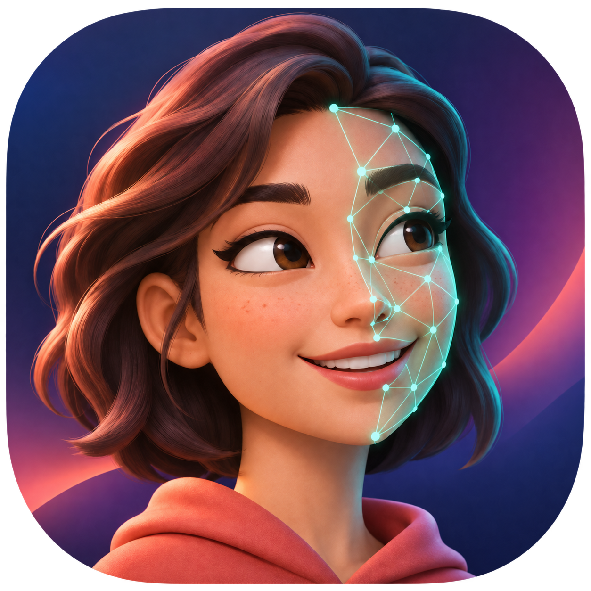
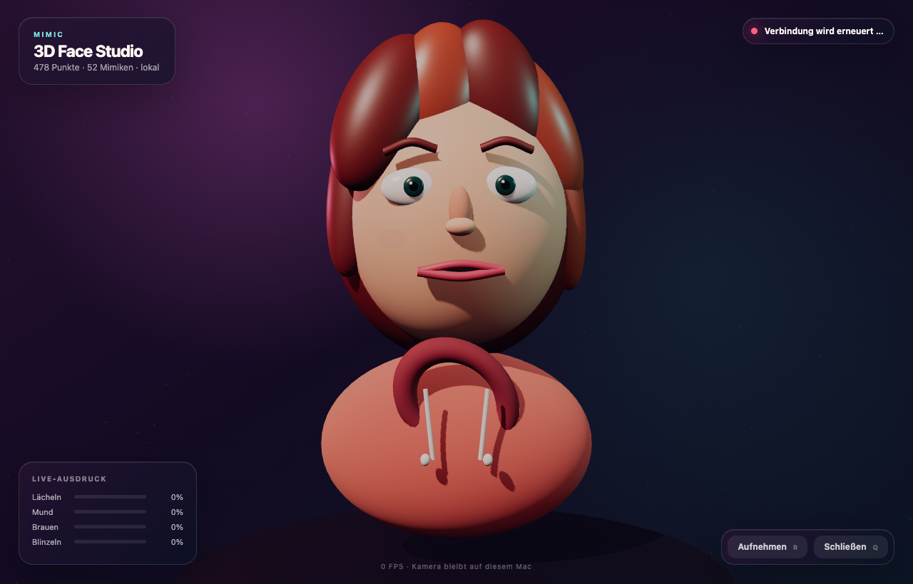

<p align="center">
  
</p>

# Gesichtsanalyse auf dem Mac

Lokale Echtzeit-Gesichtserfassung und ein mimikgesteuerter 3D-Avatar für macOS.



Die empfohlene Anwendung verwendet **MediaPipe Face Landmarker, OpenCV und Three.js**. Sie liest die Mac-Kamera lokal aus und zeigt in Echtzeit:

- ein dichtes Mesh aus 478 dreidimensionalen Gesichtspunkten,
- 52 Blendshape-Werte für Augen, Augenbrauen, Wangen, Mund und Kiefer,
- die Kopfrichtung als Yaw, Pitch und Roll,
- eine geglättete Live-Ansicht mit Messwertpanel,
- einen beleuchteten 3D-Avatar, der Kopfhaltung, Blick und Mimik übernimmt,
- optional eine JSONL-Aufzeichnung für spätere Auswertungen.

Kamerabilder werden nicht übertragen und nicht gespeichert. Nur wenn die Aufnahme aktiviert wird, schreibt die Anwendung Messwerte in den lokalen Ordner `output`. Die 3D-Oberfläche läuft ausschließlich über einen kurzlebigen Server auf `127.0.0.1`; beim Schließen des App-Fensters werden Kamera, Tracker und Server gemeinsam beendet.

## Start

Im Finder einfach **`Gesichtsanalyse.app` doppelt anklicken**. Dabei erscheint kein Terminalfenster. Beim ersten Start fragt macOS nach der Kamerafreigabe.

Nach einem frischen Klon wird die App zunächst gebaut:

```bash
./setup_python.command
```

Bedienung des 3D-Studios:

- `R`: Messwertaufnahme starten oder stoppen
- `Q`, `Esc`, „Schließen“ oder roter Fensterknopf: Anwendung vollständig beenden

Der bisherige Face-Mesh-Diagnosemodus bleibt für Entwicklung und Kontrolle verfügbar:

```bash
./start_face_mesh.command
```

Die integrierte FaceTime-Kamera ist Kamera `0`. Die erkannte iPhone-Kamera kann so gewählt werden:

```bash
./start_face_mesh.command 1
```

Direkt mit dem bisherigen 2D-Avatar starten:

```bash
./start_face_mesh.command --avatar
```

Bedienung des Diagnosemodus:

- `A`: zwischen Face-Mesh-Kamera und Avatar wechseln
- `R`: Messwertaufnahme starten oder stoppen
- `Q` oder `Esc`: Anwendung beenden
- roter Fensterknopf: Anwendung beenden

Jede Zeile einer Aufnahme enthält einen Zeitpunkt, die drei Kopfwinkel, alle verfügbaren Blendshapes und sämtliche 478 Landmarken mit normierten `x`-, `y`- und `z`-Koordinaten.

## Installation erneut ausführen

Die Installation liegt isoliert in `.venv`. Sie kann reproduzierbar erneuert werden:

```bash
./setup_python.command
```

Das Setup installiert die Python-Pakete, lädt Three.js lokal und baut anschließend das macOS-App-Bundle neu. Verwendete Hauptversionen:

- Python 3.11
- MediaPipe 0.10.21
- OpenCV 4.11
- NumPy 1.26
- Three.js 0.187
- pywebview 6.2

## Tests

```bash
.venv/bin/python -m unittest discover -s python_app -p 'test_*.py' -v
```

Der aktuelle Stand umfasst neun automatisierte Tests. Dazu gehören ein Lifecycle-Test für die Server-Portfreigabe und zwei Tests für die native macOS-Kameraberechtigung.

## Dokumentation

- [Projektstatus](docs/STATUS.md)
- [Architektur und Prozesslebenszyklus](docs/ARCHITEKTUR.md)
- [Aufzeichnungsformat und Datenschutz](docs/DATENFORMAT.md)
- [Drittanbieter und Lizenzen](THIRD_PARTY_LICENSES.md)

## Projektstruktur

- `python_app/main.py`: Kamera, MediaPipe und Benutzeroberfläche
- `python_app/app3d.py`: native App-Hülle, lokaler Server und Live-Datenbrücke
- `python_app/avatar.py`: prozeduraler, mimikgesteuerter 2D-Avatar
- `python_app/face_analysis.py`: Kopfpose, Glättung und JSONL-Export
- `web3d/`: Three.js-Szene, 3D-Avatar und Bedienoberfläche
- `Gesichtsanalyse.app`: lokal erzeugter Finder-Launcher ohne Terminalfenster
- `build_macos_app.command`: baut Icon und App-Bundle neu
- `assets/app-icon.png`: hochauflösendes App-Icon mit Transparenz
- `models/face_landmarker.task`: lokales MediaPipe-Modell
- `start_face_mesh.command`: normaler Start
- `setup_python.command`: reproduzierbare Installation
- `src/`: erhaltener Rust-Prototyp der ersten Projektphase

## Fachliche Abgrenzung

Die Blendshapes beschreiben konkrete Bewegungen wie Blinzeln, geöffneter Kiefer oder angehobene Augenbrauen. Sie sind eine geeignete Grundlage für Mimikmessungen. Eine Interpretation komplexer Emotionen oder psychischer Zustände ist damit nicht automatisch zuverlässig möglich und sollte nicht ohne gesonderte Validierung vorgenommen werden.
