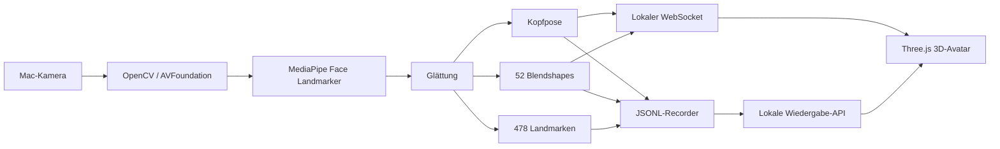

# Architektur

Die Anwendung trennt Erfassung, Auswertung, Darstellung und Speicherung. Kamerabilder verlassen den Mac nicht und werden nicht an die WebGL-Oberfläche übertragen.

## Prozesse und Komponenten

- `macos_launcher/main.c` ist der native Einstiegspunkt des App-Bundles. Dadurch ordnet macOS die Kamerafreigabe der richtigen App zu.
- `python_app/app3d.py` besitzt Kamera, MediaPipe-Instanz, Recorder und den ausschließlich an `127.0.0.1` gebundenen Server.
- `web3d/assets/app.js` baut die 3D-Szene und überträgt Kopfpose sowie Blendshapes auf den Avatar.
- `python_app/face_analysis.py` enthält Glättung, Kopfpose-Konvertierung und JSONL-Export.
- Die Wiedergabe-API listet ausschließlich Dateien aus `output/` und liefert nur Zeitstempel, Kopfpose und Blendshapes an die Oberfläche. Dateinamen werden gegen Pfadwechsel validiert.

## Lebenszyklus

1. Der native Launcher startet den eingebetteten Python-Einstiegspunkt.
2. macOS prüft beziehungsweise erfragt die Kamerafreigabe.
3. Ein lokaler HTTP-/WebSocket-Server erhält einen freien, dynamischen Port.
4. Die native WebView lädt die Three.js-Oberfläche von diesem Port.
5. Der Tracker sendet nur Messwerte, keine Kamerabilder, an die Darstellung.
6. Beim Schließen werden Recorder, Kamera, MediaPipe, WebSockets und Server beendet.

Der Lifecycle-Test in `python_app/test_app3d.py` prüft zusätzlich, dass der Serverport danach nicht mehr belegt ist.
